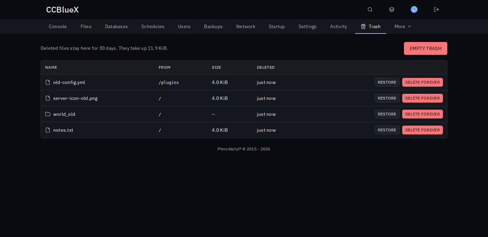

# Trash Bin for Pterodactyl

Files deleted in the file manager go to a trash first, so a wrong click can be undone. Works with every game.

## Install

1. Download `trash-bin-<version>.pteroext` from the [latest release](https://github.com/CCBlueX/Pterodactyl-Extension-Trash-Bin/releases/latest).
2. Install and enable it under **Admin → Extensions**.
3. Delete a file as usual, then click **Trash** next to **New folder** (or open the server's **Trash** tab).

## Features

- **Restore**: files and folders go back where they were. Missing folders are recreated, taken names get a number.
- **Delete permanently**: tick files in the file manager to skip the trash. Or **Delete forever** and **Empty trash** on the Trash screen.
- **Per-server switch**: turn the trash off for a server and see who changed it. Anyone who can delete files can use both.
- **Cleans up**: trashed files are deleted after 30 days, or keep them until you empty the trash.
- **Stays out of the way**: the trash folder is hidden, and only deletes made in the file manager are trashed.

Trashed files still count towards the server's disk space.
